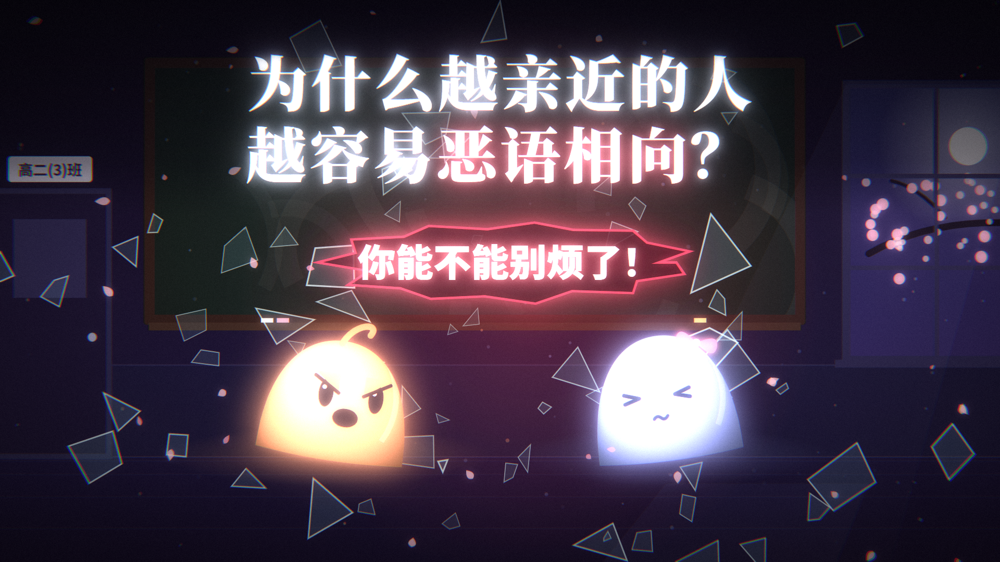

# 为什么越亲近的人越容易恶语相向？

一部以校园恋爱为背景、由代码绘制画面和动画的心理科普短片。开源版保留原画面和全部 157 个程序合成音效，移除了《We Never》背景音乐。



**允许商业用途：源码采用 MIT，原创内容采用 CC BY 4.0，第三方字体采用 SIL OFL 1.1。** 使用内容时请署名并说明改动，具体范围见 [内容许可](LICENSE-CONTENT.md)。

## 音频标注

《We Never》（世纪Official）已从本次开源成片移除。歌曲本体、原有含歌混音和含歌历史视频均不分发。粉笔、碎裂、打字、脚步、雨声及其他全部音效保持原来的触发、声像、混响和音量，不是将整条音轨静音。完整记录见 [音频说明](AUDIO-RIGHTS.md)。

成片和无损音效 WAV 在发行附件中提供。仓库包含复现它们所需的代码、字体和数值配置；运行时不需要歌曲文件。

## 片子讲了什么

对隔壁班的陌生人说“没关系”，对在一起很久的 TA 却更容易说重话。短片围绕四个解释展开：笃定对方不会走、期待与现实的落差、情绪转移，以及自我扩展中的关系融合。最后给出停一下、用感受表达代替攻击、把耐心留给亲近之人的建议。

心理学内容是故事化的科普表达，不构成心理咨询或诊断。

## 制作与目录

原工程记录为由 Claude Opus 辅助代码制作。画面主体和动画由 Canvas / WebGL 绘制，音效由 NumPy / SciPy 合成；字体为第三方开放字体。

```text
src/scenes/             开场、四个原因、结尾
src/worlds.js           天台、手机、街道、星空、雨窗、书桌、樱花校门
src/campus.js           教室
src/cover.js            三个比例的封面构图
music.py / synth.py     纯程序音效、滤波和混响
audio/                  原音效增益和数值增益自动化，不含歌曲采样
fonts/                  本地字体及各自的 OFL 全文
tools/                  预览服务、字体下载、封面生成等工具
export.mjs              逐帧渲染并导出视频
out/cover_*.png         16:9、4:3、3:4 封面
tests/                  无歌曲文件的完整音效导出回归检查
```

`pieces.py` 和 `instruments.py` 为原工程早期程序配乐源码，保留作开发参考。本次成片和默认导出不会播放它们，也没有新增替代 BGM。

## 本地复现

已在 Windows、Node.js 24.17.0、Python 3.12、Chrome 和 FFmpeg 环境核验。其他系统未实测。需要 Node.js 22+、Python 3.12、FFmpeg，以及本机 Chrome 或 Edge。

```text
npm ci --ignore-scripts --no-audit --no-fund
python -m pip install -r requirements.txt
node export.mjs --cues
python -B music.py --report
node export.mjs --out out/closer-words-sfx-only.mp4
node tools/covers.mjs
```

用 `npm run serve` 打开本地预览地址；空格播放或暂停，左右键按小节跳转，Shift + 左右键按拍跳转。`npm run test:audio` 检查无歌曲文件时的完整音效生成。

已附带本片使用的字体，不必先联网下载。修改画面文字后可运行 `npm run fonts` 更新字形子集；字体许可文件仍须保留。找不到浏览器时，设置 `CHROME_PATH` 为自己的浏览器程序位置。

本片保留原来的 112.9039 BPM 画面时间轴，因此移除歌曲不会改变剪辑。数值音效配置针对当前 157 个触发；修改音效或时间轴后，需要相应更新音效增益配置，脚本会在配置不匹配时明确报错。

`tools/analyze_song.py` 仅为原工程的可选节奏分析工具，不属于无 BGM 复现步骤。如果自行加入音乐，须自己取得适合该用途的授权；本仓库的 MIT / CC BY 4.0 不授权任何另行加入的第三方歌曲。

## 许可与致谢

| 内容 | 许可 | 商业用途 |
|---|---|---|
| 原创源码、软件说明和数值配置 | [MIT](LICENSE) | 允许，保留版权和许可文本 |
| 原创画面、封面、角色、故事文案、字幕、合成音效和去歌成片 | [CC BY 4.0](LICENSE-CONTENT.md) | 允许，适当署名、链接许可并说明改动 |
| Noto Sans SC、Noto Serif SC、Noto Serif、JetBrains Mono | SIL OFL 1.1 | 按字体许可使用 |
| 运行依赖 | 各自许可 | 详见 [第三方声明](THIRD-PARTY-NOTICES.md) |

原创内容署名示例：原作 Huamucuo（https://github.com/Huamucuo），《为什么越亲近的人越容易恶语相向？》，CC BY 4.0；本版本已移除《We Never》，其他修改请另行说明。

感谢字体作者及 Puppeteer、NumPy、SciPy、FFmpeg 项目。《We Never》版权归其权利人，本次开源许可不包含该歌曲。
